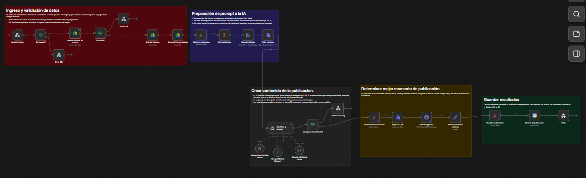
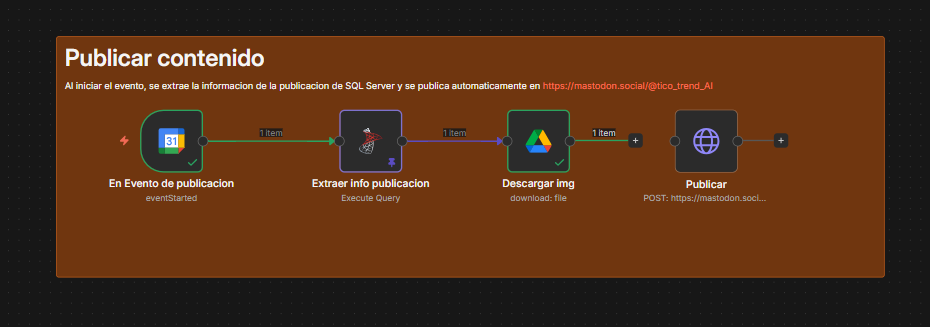
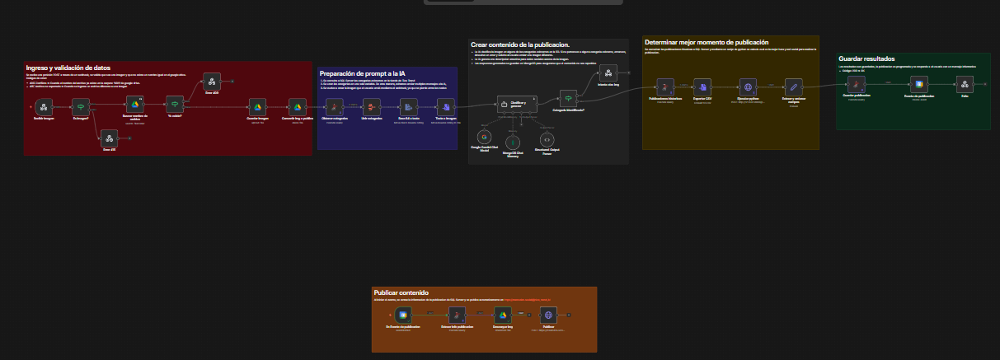

# Marketing Digital — Flujo n8n

Flujo de automatizacion de marketing digital para la tienda **Tico Trend** (Cartago, Costa Rica). A partir de una imagen enviada por webhook, el flujo clasifica el producto con IA, genera una descripcion optimizada para redes sociales, determina el mejor momento de publicacion y programa la publicacion automaticamente en Mastodon.

---

## Arquitectura general

El flujo esta dividido en dos grandes secciones:

**Seccion 1 — Procesamiento y programacion (disparado por webhook)**



**Seccion 2 — Publicacion automatica (disparado por Google Calendar)**



---

## Nodos del flujo

### Ingreso y validacion de datos

| Nodo | Tipo | Descripcion |
|---|---|---|
| Recibir imagen | Webhook | Recibe `POST /enviar-img` con una imagen adjunta como `binary.data0` |
| Es imagen? | IF | Verifica que el archivo recibido sea de tipo `image/*` |
| Error 415 | Respond to Webhook | Retorna HTTP 415 si el archivo no es una imagen |
| Buscar nombre de archivo | Google Drive | Busca en la carpeta `N8N` si ya existe un archivo con el mismo nombre |
| Ya existe? | IF | Evalua si la busqueda anterior retorno algun resultado |
| Error 409 | Respond to Webhook | Retorna HTTP 409 con el enlace al archivo duplicado |
| Guardar imagen | Google Drive | Sube la imagen a la carpeta `N8N` en Google Drive |
| Convertir img a publica | Google Drive | Agrega permiso de lectura publica (`anyone: reader`) al archivo subido |

### Preparacion del prompt para la IA

| Nodo | Tipo | Descripcion |
|---|---|---|
| Obtener categorias | Microsoft SQL | Consulta las categorias distintas de la tabla `MarketingDigitalPruebas` |
| Unir categorias | Aggregate | Consolida todas las categorias en una sola variable para el prompt |
| Base 64 a texto | Extract From File | Convierte el binario de la imagen a texto base64 |
| Texto a imagen | Convert To File | Reconstruye el binario de la imagen (se pierde entre nodos) |

### Clasificacion y generacion de contenido

| Nodo | Tipo | Descripcion |
|---|---|---|
| Clasificar y generar | AI Agent | Envia la imagen y las categorias a Google Gemini. Clasifica el producto y genera una descripcion de hasta 40 palabras con 3 hashtags para redes sociales |
| Google Gemini Chat Model | LM Chat (Gemini) | Modelo de lenguaje utilizado por el agente |
| Structured Output Parser | Output Parser | Fuerza la respuesta del agente a JSON con los campos `Categoria` y `Descripcion` |
| MongoDB Chat Memory | Memory | Guarda el historial de conversacion en MongoDB (`db_n8n.ai_chat`) para evitar contenido repetitivo |
| Categoria identificada? | IF | Verifica que la respuesta del agente contenga una categoria y descripcion validas |
| Intente otra img | Respond to Webhook | Retorna error si la imagen no pudo clasificarse en ninguna categoria existente |

### Determinacion del mejor momento de publicacion

| Nodo | Tipo | Descripcion |
|---|---|---|
| Publicaciones historicas | Microsoft SQL | Consulta el historial de publicaciones de la misma categoria en SQL Server |
| Exportar CSV | Convert To File | Convierte el historial a formato CSV |
| Ejecutar python | HTTP Request | Envia el CSV a la API de Python local (`POST http://127.0.0.1:8000/procesar-csv`) con el header `x-api-key: api-key-123`. Retorna el mejor momento y red social |

### Guardado y programacion

| Nodo | Tipo | Descripcion |
|---|---|---|
| Extraer y ordenar campos | Set | Construye los campos `img_link`, `red`, `cat`, `fecha_inicio` y `fecha_fin` a partir de los resultados anteriores |
| Guardar publicacion | Microsoft SQL | Inserta la publicacion en `MarketingDigitalPruebas` con fecha, red social, categoria, descripcion y enlace a la imagen |
| Evento de publicacion | Google Calendar | Crea un evento en el calendario `Marketing` con titulo `Publicacion de {categoria} en {red}` y el `id` de la publicacion en la descripcion |
| Exito | Respond to Webhook | Retorna HTTP 200 con mensaje de confirmacion, fecha programada, categoria, descripcion y red social |

### Publicacion automatica

| Nodo | Tipo | Descripcion |
|---|---|---|
| En Evento de publicacion | Google Calendar Trigger | Se activa cada minuto verificando si inicio algun evento con el termino "Publicacion" en el calendario `Marketing` |
| Extraer info publicacion | Microsoft SQL | Consulta todos los datos de la publicacion usando el `id` guardado en la descripcion del evento |
| Descargar img | Google Drive | Descarga la imagen desde Google Drive |
| Publicar | HTTP Request | Publica en [mastodon.social](https://mastodon.social/@tico_trend_AI) usando OAuth2. Incluye la descripcion y el enlace a la imagen |

---

## Servicios y credenciales requeridos

| Servicio | Uso |
|---|---|
| Google Drive | Almacenar y compartir imagenes de productos |
| Google Calendar | Programar y disparar publicaciones |
| Microsoft SQL Server | Persistencia de publicaciones e historico |
| MongoDB | Memoria de conversacion del agente de IA |
| Google Gemini (Gemini Chat) | Clasificacion de imagenes y generacion de contenido |
| Mastodon (OAuth2) | Publicacion en redes sociales |
| API Python (local) | Analisis de datos historicos para determinar mejor hora y red social |

---

## API de Python

El nodo **Ejecutar python** se comunica con una API local de FastAPI. Esta debe levantarse antes de ejecutar el flujo.

**Endpoint:** `POST http://127.0.0.1:8000/procesar-csv`

**Autenticacion:** Header `x-api-key: api-key-123`

**Body:** archivo CSV con el historico de publicaciones (`FechaPublicacion`, `CantidadLikes`, `NombreRedSocial`, `Categoria`)

**Respuesta esperada:** JSON con el campo `mejor_momento` que contiene al menos `NombreRedSocial` y la fecha/hora optima de publicacion.

### Como levantar la API

```bash
python -m uvicorn main:app
```

Para levantar con recarga automatica en desarrollo:

```bash
python -m uvicorn main:app --reload
```

---

## Codigos de respuesta del webhook

| Codigo | Descripcion |
|---|---|
| 200 | Publicacion programada correctamente |
| 409 | Ya existe un archivo con el mismo nombre en Google Drive |
| 415 | El archivo enviado no es una imagen |

---

## Estructura de la base de datos (SQL Server)

Tabla principal: `MarketingDigitalPruebas`

| Campo | Descripcion |
|---|---|
| `id` | Identificador unico de la publicacion |
| `FechaPublicacion` | Fecha y hora de la publicacion (DATETIME2) |
| `NombreRedSocial` | Red social donde se publico |
| `Categoria` | Categoria del producto |
| `Descripcion` | Texto generado por la IA |
| `LinkImagen` | URL publica de la imagen en Google Drive |
| `CantidadLikes` | Cantidad de likes obtenidos (usado para el analisis historico) |

---

## Diagrama de flujo completo




## Demostración
[Ver video de demostración del flujo](https://drive.google.com/file/d/1JGivIsmyvSJt9HlfatIAVauF9qOcwmXx/view?usp=sharing)